# WattPrint web

Dashboard và trang giới thiệu của WattPrint: Next.js 16 và React 19 trong monorepo pnpm + Turborepo, giao diện shadcn/ui và Hairline UI, đăng nhập bằng Keycloak, dữ liệu từ backend FastAPI.

- Backend: repo `wattprint-backend` (https://github.com/daFoggo/wattprint-backend). Web cần backend đang chạy (API ở `:11093`, Keycloak ở `:11095`).
- Quy ước dự án nằm ở [docs/](docs/); mục lục ở [AGENTS.md](AGENTS.md).

## Kiến trúc



| Thư mục | Là gì | Cổng dev / prod |
|---|---|---|
| [`apps/dashboard`](apps/dashboard) | Đăng nhập và dashboard (tổng quan, thống kê, thiết bị, cảnh báo, kế hoạch, hóa đơn, cài đặt, Wappi) | 11092 / 11082 |
| [`apps/web`](apps/web) | Trang giới thiệu công khai; chuyển tiếp `sign-in`, `dashboard`, `auth` sang dashboard (multi-zone) | 11091 / 11081 |
| [`apps/keycloak-theme`](apps/keycloak-theme) | Giao diện đăng nhập, đăng ký, đặt lại mật khẩu của Keycloak, build thành file jar | 11098 (xem trước) |
| [`packages/auth`](packages/auth) | `@workspace/auth`: Keycloak OIDC, cookie phiên, kiểm tra JWT; chỉ dashboard import | |
| [`packages/ui`](packages/ui) | `@workspace/ui`: component shadcn/ui và Hairline UI, kiểu chung | |
| [`packages/ui-patterns`](packages/ui-patterns) | `@workspace/ui-patterns`: ThemeProvider, ThemeToggle, AppLogo, avatar Wappi, StackGrid | |
| `packages/eslint-config`, `packages/typescript-config` | Cấu hình dùng chung | |

`apps/` chứa thứ chạy được, `packages/` chứa thứ dùng chung; package có tên `@workspace/*`, khai báo bằng `workspace:*`, không lồng nhau và không import bằng `../`.

### Đăng nhập và lấy dữ liệu



- Chỉ hỗ trợ `AUTH_PROVIDER=keycloak`. Token nằm trong cookie `httpOnly` (`.access`, `.refresh`, `.id`, `.pkce`); `proxy.ts` làm mới token và chuyển người chưa đăng nhập khỏi `/dashboard`. Token không bao giờ tới trình duyệt.
- Dữ liệu: `features/<tên>/server.ts` gọi `apiFetch` (`lib/http.ts`) với Bearer token rồi kiểm bằng schema Zod; lỗi 401 từ API đưa người dùng tới `/auth/expired` để xóa cookie. Chat Wappi đi qua `/api/copilot/chat` (SSE), `/api/copilot/voice/*`.
- **Xem nhà demo** (không cần tài khoản): dashboard gọi `POST /demo/homes/{key}/guest` của backend với `X-Demo-Secret` (chính là `KEYCLOAK_CLIENT_SECRET`); tài khoản khách bị xóa sau khoảng một ngày.
- Chi tiết: [docs/providers.md](docs/providers.md), [docs/authentication.md](docs/authentication.md).

## Cài đặt

> Trong bản nộp, web được build và chạy bằng Docker bởi `./setup.sh` ở thư mục gốc; phần này dành cho phát triển.

### Yêu cầu

- Node.js 22 (`.nvmrc`) và pnpm 11.25 (`corepack enable`; `packageManager` trong `package.json`).
- Backend đang chạy: `docker compose up -d` trong `wattprint-backend` (API `:11093`, Keycloak `:11095`).
- Java 21 và Maven, chỉ khi build lại giao diện Keycloak (`pnpm --filter keycloak-theme build:jar`).

### Các bước

```bash
pnpm install
cp apps/dashboard/.env.example apps/dashboard/.env.local
cp apps/web/.env.example apps/web/.env.local
```

Trong `apps/dashboard/.env.local` đặt `KEYCLOAK_CLIENT_SECRET` bằng `WATTPRINT_WEB_CLIENT_SECRET` của `.env` backend (bắt buộc, kể cả khi build). Các biến còn lại có giá trị mặc định chạy được trên máy phát triển:

| Biến | Ý nghĩa |
|---|---|
| `AUTH_PROVIDER` | Phải là `keycloak` |
| `KEYCLOAK_ISSUER` | URL realm, mặc định `http://localhost:11095/realms/wattprint`; phải trùng `iss` của token |
| `KEYCLOAK_CLIENT_ID` | `wattprint-web` |
| `KEYCLOAK_CLIENT_SECRET` | Bí mật của client, bắt buộc |
| `API_BASE_URL` | API backend, mặc định `http://localhost:11093/api/v1` |
| `NEXT_PUBLIC_APP_URL`, `NEXT_PUBLIC_LANDING_URL` | URL công khai của dashboard (`:11092`) và trang giới thiệu (`:11091`) |

`apps/web/.env.local`: `NEXT_PUBLIC_APP_URL` (`:11091`), `NEXT_PUBLIC_DASHBOARD_URL` và `DASHBOARD_ORIGIN` (`:11092`).

```bash
pnpm dev                                # web :11091 và dashboard :11092
pnpm turbo run dev --filter=dashboard   # chỉ dashboard
```

Mở http://localhost:11092, bấm **Xem nhà demo** hoặc đăng nhập bằng tài khoản đã nạp ở backend.

### Chạy bản production bằng Docker

```bash
docker compose up -d --build
```

`compose.yaml` build một image (`Dockerfile`, Node 22) và chạy hai dịch vụ: `dashboard` ở `:11082` và `web` ở `:11081`, cả hai dùng mạng host và đọc `apps/*/.env.local` (đưa vào lúc build qua secret, không nằm trong layer). `apps/web/.env.local` phải có `NEXT_PUBLIC_APP_URL`, nếu không build dừng.

## Kiểm thử, lint và CI

```bash
pnpm check          # lint + typecheck + test (vitest) của mọi package
pnpm build
pnpm --filter dashboard test:e2e     # Playwright, cần BASE_URL
```

`.github/workflows/ci.yml` chạy `pnpm turbo run lint typecheck test --affected` rồi `pnpm turbo run build --affected` trên mỗi pull request và push lên `main`. Commit theo Conventional Commits (commitlint qua husky). Xem [CONTRIBUTING.md](CONTRIBUTING.md).

## Ngôn ngữ

Tiếng Việt là mặc định (không có tiền tố đường dẫn), tiếng Anh dưới `/en`. Chuỗi giao diện nằm ở `apps/dashboard/messages/{vi,en}/*.json`; múi giờ cố định `Asia/Ho_Chi_Minh`. Xem [docs/internationalization.md](docs/internationalization.md).

## Thêm component

```bash
pnpm dlx shadcn@latest add button -c apps/dashboard
```

Component shadcn vào `packages/ui/src/components/ui`, Hairline UI vào `packages/ui/src/components/hairline` (`pnpm --filter @workspace/ui hairline`). Ưu tiên Hairline; xem [docs/design-system.md](docs/design-system.md).

## Tài liệu

| Việc | Đọc |
|---|---|
| Thêm một tính năng từ đầu đến cuối | [docs/adding-a-feature.md](docs/adding-a-feature.md) |
| Cấu trúc thư mục, ranh giới ESLint | [docs/project-structure.md](docs/project-structure.md) |
| Tải dữ liệu, cache, mutation | [docs/data-fetching.md](docs/data-fetching.md) |
| Route, layout | [docs/routing-and-layouts.md](docs/routing-and-layouts.md) |
| Xác thực, phân quyền | [docs/authentication.md](docs/authentication.md), [docs/providers.md](docs/providers.md) |
| Giao diện, màu, khoảng cách | [docs/design-system.md](docs/design-system.md) |
| Hiệu năng | [docs/performance-optimization.md](docs/performance-optimization.md) |
| Nợ kỹ thuật | [docs/debt.md](docs/debt.md) |
